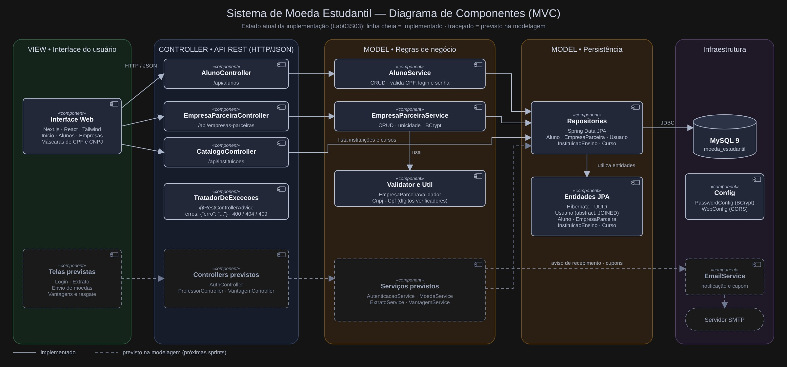

# 🪙 Sistema de Moeda Estudantil

Sistema para estimular o reconhecimento do mérito estudantil por meio de uma moeda virtual: professores distribuem moedas aos alunos como reconhecimento, e os alunos trocam essas moedas por produtos e descontos oferecidos por empresas parceiras.

> 📚 Projeto desenvolvido para a disciplina **Laboratório de Projeto de Software** — PUC Minas, Laboratório 3, 2º semestre/2026
>
> 👩‍🏫 Profa. Milena Menezes Adão

---

## 📌 Sumário

- [📖 Sobre](#-sobre)
- [🎯 Objetivo](#-objetivo)
- [🧭 Escopo Implementado](#-escopo-implementado)
- [👥 Atores](#-atores)
- [🗂️ Casos de Uso](#️-casos-de-uso)
- [📝 Histórias de Usuário](#-histórias-de-usuário)
- [⚙️ Regras de Negócio](#️-regras-de-negócio)
- [🗺️ Diagrama de Caso de Uso](#️-diagrama-de-caso-de-uso)
- [🧩 Diagrama de Classes](#-diagrama-de-classes)
- [🗄️ Modelo Entidade-Relacionamento (ER)](#️-modelo-entidade-relacionamento-er)
- [🏗️ Diagrama de Componentes](#️-diagrama-de-componentes)
- [🎓 API — Alunos](#-api--alunos)
- [🧪 Testes da Lab03S03](#-testes-da-lab03s03)
- [📊 Apresentação da Lab03S03](#-apresentação-da-lab03s03)
- [🚀 Status do Projeto](#-status-do-projeto)
- [✍️ Autores](#️-autores)

---

## 📖 Sobre

O **Sistema de Moeda Estudantil** é uma plataforma de reconhecimento de mérito acadêmico baseada em uma moeda virtual. A cada semestre, professores vinculados às instituições parceiras recebem um montante de moedas que podem distribuir aos seus alunos por bom comportamento, participação em aula e outros motivos. Os alunos acumulam essas moedas e as trocam por vantagens cadastradas por empresas parceiras, como descontos em restaurantes da universidade, desconto de mensalidade ou compra de materiais específicos.

O sistema conecta três perfis de usuário: aluno, professor e empresa parceira. Também se integra a um serviço de envio de emails, responsável por notificar o recebimento de moedas e por entregar os cupons de resgate.

## 🎯 Objetivo

Fornecer uma solução centralizada que permita:

- Cadastrar alunos e empresas parceiras no sistema de mérito
- Creditar semestralmente moedas aos professores, de forma acumulável
- Permitir que professores reconheçam alunos com envio de moedas e motivo obrigatório
- Notificar o aluno por email a cada reconhecimento recebido
- Permitir a consulta de extrato de conta por professores e alunos
- Permitir que empresas parceiras cadastrem vantagens com descrição, foto e custo em moedas
- Permitir que alunos resgatem vantagens, debitando o valor do seu saldo
- Gerar e enviar por email o código do cupom ao aluno e ao parceiro, para conferência da troca
- Garantir o acesso autenticado de todos os perfis de usuário

## 🧭 Escopo Implementado

A modelagem (casos de uso, classes, ER e componentes) cobre o sistema completo. A implementação segue as sprints da disciplina:

| Funcionalidade | Situação |
|---|---|
| CRUD de alunos, com seleção de instituição e curso | ✅ Implementado |
| CRUD de empresas parceiras | ✅ Implementado |
| Instituições de ensino e cursos pré-cadastrados | ✅ Implementado (carga por script SQL) |
| Validação de CPF, CNPJ, e-mail, login e senha | ✅ Implementado |
| Senhas armazenadas com hash BCrypt | ✅ Implementado |
| Tratamento padronizado de erros da API (`400`, `404`, `409`) | ✅ Implementado |
| Autenticação (login) dos três perfis | ⏳ Previsto na modelagem |
| Professores pré-cadastrados, saldo e crédito semestral | ⏳ Previsto na modelagem |
| Envio de moedas e extrato | ⏳ Previsto na modelagem |
| Vantagens, resgate e cupom | ⏳ Previsto na modelagem |
| Envio de e-mails | ⏳ Previsto na modelagem |

## 👥 Atores

| Ator | Descrição |
|---|---|
| 🎒 **Aluno** | Realiza seu próprio cadastro, consulta extrato e troca moedas por vantagens |
| 👩‍🏫 **Professor** | Pré-cadastrado pela instituição; distribui moedas aos alunos e consulta seu extrato |
| 🏢 **Empresa Parceira** | Realiza seu cadastro e mantém as vantagens oferecidas aos alunos |
| 🏫 **Instituição de Ensino** | Pré-cadastrada no sistema; envia a lista de professores no momento da parceria |
| 📧 **Serviço de Email** *(externo)* | Recebe as solicitações de envio de notificações e de cupons de resgate |

## 🗂️ Casos de Uso

### 🔑 Comuns a todos os perfis

| Caso de uso | Ator | Descrição |
|---|---|---|
| **UC01** — Autenticar no sistema | Aluno, Professor, Empresa Parceira | Acessa o sistema por meio de login e senha |

### 🎒 Aluno

| Caso de uso | Descrição |
|---|---|
| **UC02** — Cadastrar-se como aluno | Informa nome, email, CPF, RG, endereço, login e senha, e seleciona a instituição de ensino e o curso |
| **UC03** — Consultar extrato da conta | Visualiza o saldo atual de moedas e o histórico de recebimentos e trocas *(compartilhado com o Professor)* |
| **UC04** — Consultar vantagens disponíveis | Lista as vantagens cadastradas pelas empresas parceiras, com descrição, foto e custo |
| **UC05** — Resgatar vantagem | Seleciona uma vantagem e tem o custo debitado do saldo; inclui **UC10** (gera o código) e **UC11** (envia o cupom ao aluno e o comprovante ao parceiro) |

### 👩‍🏫 Professor

| Caso de uso | Descrição |
|---|---|
| **UC03** — Consultar extrato da conta | Visualiza o saldo atual de moedas e o histórico de envios realizados |
| **UC06** — Enviar moedas a um aluno | Seleciona o aluno, informa o montante e o motivo do reconhecimento; inclui **UC11** (notifica o aluno por email) |

### 🏢 Empresa Parceira

| Caso de uso | Descrição |
|---|---|
| **UC07** — Cadastrar-se como empresa parceira | Informa os dados da empresa, login e senha |
| **UC08** — Manter vantagens | Cadastra, altera e remove vantagens, informando descrição, foto e custo em moedas |

### ⚙️ Casos de uso do sistema

| Caso de uso | Ator | Descrição |
|---|---|---|
| **UC09** — Creditar moedas semestrais aos professores | Tempo | A cada semestre, adiciona 1.000 moedas ao saldo corrente de cada professor |
| **UC10** — Gerar código de cupom | — | Gera o código que identifica o resgate e é enviado ao aluno e ao parceiro |
| **UC11** — Enviar email | Serviço de Email | Aciona o serviço externo para notificar o aluno sobre moedas recebidas e para entregar cupom (aluno) e comprovante (parceiro) com o código gerado |

## 📝 Histórias de Usuário

### 🎒 Aluno

- Como aluno, quero me cadastrar no sistema informando meus dados pessoais e selecionando minha instituição e curso, para poder participar do sistema de mérito.
- Como aluno, quero fazer login no sistema, para acessar minhas funcionalidades com segurança.
- Como aluno, quero ser notificado por email quando receber moedas, para saber que fui reconhecido e por qual motivo.
- Como aluno, quero consultar o extrato da minha conta, para visualizar meu saldo de moedas e as transações que realizei.
- Como aluno, quero visualizar as vantagens disponíveis com descrição, foto e custo, para decidir no que gastar minhas moedas.
- Como aluno, quero resgatar uma vantagem usando meu saldo, para aproveitar o benefício oferecido pela empresa parceira.
- Como aluno, quero receber por email um cupom com código após o resgate, para utilizá-lo na troca presencial.

### 👩‍🏫 Professor

- Como professor, quero fazer login no sistema, para acessar minhas funcionalidades.
- Como professor, quero receber 1.000 moedas a cada semestre, de forma acumulável, para ter como reconhecer meus alunos ao longo do curso.
- Como professor, quero enviar moedas a um aluno informando o motivo do reconhecimento, para valorizar seu bom comportamento e participação em aula.
- Como professor, quero consultar o extrato da minha conta, para acompanhar meu saldo e os envios que já realizei.

### 🏢 Empresa Parceira

- Como empresa parceira, quero me cadastrar no sistema, para oferecer vantagens aos alunos participantes.
- Como empresa parceira, quero cadastrar vantagens com descrição, foto e custo em moedas, para divulgar o que ofereço aos alunos.
- Como empresa parceira, quero alterar e remover as vantagens que cadastrei, para manter minhas ofertas atualizadas.
- Como empresa parceira, quero receber por email o código do cupom resgatado por um aluno, para conferir a troca no momento do atendimento.

### 📧 Serviço de Email *(integração)*

- Como sistema de moeda estudantil, quero acionar o serviço de email a cada recebimento de moedas e a cada resgate de vantagem, para que aluno e parceiro sejam informados e possam conferir a transação pelo código gerado.

## ⚙️ Regras de Negócio

- 🔑 Alunos, professores e empresas parceiras possuem login e senha, e toda operação exige autenticação.
- 🏫 As instituições de ensino já estão pré-cadastradas no sistema, para seleção pelo aluno.
- 👩‍🏫 Os professores já estão pré-cadastrados no sistema, a partir da lista enviada pela instituição no momento da parceria, e armazenam nome, CPF e departamento, sempre vinculados a uma instituição.
- 🪙 Cada professor recebe 1.000 moedas por semestre, e esse total é **acumulável**: moedas não distribuídas permanecem no saldo corrente quando o novo crédito é feito.
- 💸 O professor só pode enviar moedas se possuir saldo suficiente para o montante informado.
- ✍️ O motivo do reconhecimento é uma mensagem aberta e de preenchimento **obrigatório** no envio de moedas.
- 📩 O aluno é notificado por email a cada recebimento de moedas.
- 📉 O resgate de uma vantagem debita o custo em moedas do saldo do aluno.
- 🎟️ Todo resgate gera um código pelo sistema, enviado por email tanto ao aluno (cupom) quanto à empresa parceira (conferência).
- 🧾 Toda vantagem cadastrada deve possuir descrição, foto do produto e custo em moedas.
- 📊 O extrato apresenta o saldo atual e as transações do usuário: envios, no caso do professor; recebimentos e trocas, no caso do aluno.

## 🗺️ Diagrama de Caso de Uso


## 🧩 Diagrama de Classes


## 🗄️ Modelo Entidade-Relacionamento (ER)

O Modelo Entidade-Relacionamento (ER) representa a estrutura
do banco de dados do Sistema de Moeda Estudantil, desenvolvido
a partir do diagrama de classes.

O modelo apresenta as entidades, seus atributos, chaves
primárias (PK), chaves estrangeiras (FK) e cardinalidades
dos relacionamentos.


## 🏗️ Diagrama de Componentes



## 🛠️ Tecnologias

| Camada | Tecnologia |
|---|---|
| **Back-end** | Java 17, Spring Boot 4.1, Spring Web MVC, Spring Data JPA (Hibernate) |
| **Banco de dados** | MySQL 9 |
| **Segurança** | BCrypt (`spring-security-crypto`) para o hash das senhas |
| **Front-end** | Next.js, React, TypeScript e Tailwind CSS |
| **Build** | Maven (wrapper `mvnw` incluso no projeto) |

## 🏛️ Arquitetura e Acesso a Dados

O back-end segue a arquitetura em camadas (MVC), exposta como uma **API REST** consumida pelo front-end:

```
Front-end (Next.js)  ──HTTP/JSON──▶  Controller  ──▶  Service  ──▶  Repository  ──▶  MySQL
                                        │              │               │
                                       DTOs      regras de negócio   JPA / Hibernate
```

| Camada | Pacote | Responsabilidade |
|---|---|---|
| **Controller** | `controller` | Recebe as requisições HTTP e devolve as respostas |
| **Service** | `service` | Concentra as regras de negócio e as transações |
| **Repository** | `repository` | Acesso ao banco via Spring Data JPA |
| **Model** | `model` | Entidades JPA mapeadas para as tabelas |
| **DTO** | `dto` | Objetos de entrada e saída da API (a senha nunca é devolvida) |
| **Validator** | `validator` | Validação dos dados de entrada antes das regras de negócio |
| **Util** | `util` | Utilitários de validação e formatação (CPF e CNPJ) |
| **Exception** | `exception` | Exceções de negócio e tratamento centralizado de erros |
| **Config** | `config` | Configurações (codificador de senhas, CORS) |

**Estratégia de acesso ao banco: ORM.** O mapeamento objeto-relacional é feito com **JPA/Hibernate**:

- As entidades são classes Java anotadas, e o Hibernate gera e executa o SQL.
- `Usuario` é uma classe abstrata com herança do tipo `JOINED`: cada perfil (como `EmpresaParceira`) tem a sua própria tabela, ligada à tabela `usuario` pela chave primária compartilhada. Isso evita colunas vazias e permite reutilizar login e senha entre os perfis.
- Os identificadores são `UUID`.
- As senhas são armazenadas apenas como hash **BCrypt**.
- Nesta fase, o esquema é atualizado automaticamente pelo Hibernate (`ddl-auto=update`). Quando o modelo ER estiver fechado, a ideia é migrar para `validate` com um script SQL versionado.

**Tratamento de erros.** Todas as respostas de erro da API seguem o formato `{"erro": "mensagem"}`, produzido por um tratador centralizado (`TratadorDeExcecoes`):

| Status | Quando ocorre |
|---|---|
| `400` | Dados inválidos, campo obrigatório ausente, JSON malformado ou id em formato inválido |
| `404` | Registro não encontrado |
| `409` | Login, e-mail, CNPJ ou CPF já cadastrado |

## 📁 Estrutura do Repositório

```
sistema-moeda-estudantil/
├── backend/
│   ├── src/main/java/br/com/sistemamoedaestudantil/
│   │   └── sistema_moeda_estudantil/
│   │       ├── config/
│   │       ├── controller/
│   │       ├── dto/
│   │       ├── exception/
│   │       ├── model/
│   │       ├── repository/
│   │       ├── service/
│   │       ├── util/
│   │       └── validator/
│   └── scripts/
│       └── testar-empresas.sh
├── frontend/
│   └── app/
│       ├── componentes/
│       ├── alunos/page.tsx
│       ├── empresas/page.tsx
│       └── page.tsx
├── database/
│   └── 03_alunos_instituicoes_cursos.sql
├── docs/
│   └── (diagramas UML e modelo ER)
├── tests/
│   └── teste-api-alunos.ps1
└── README.md
```

## ▶️ Como Executar

**Pré-requisitos:** Java 17 ou superior, Node.js 20 ou superior e MySQL em execução em `localhost:3306`.

**1. Banco de dados**

O banco `moeda_estudantil` é criado automaticamente na primeira execução. Por padrão a aplicação usa o usuário `root` sem senha; para usar outras credenciais, defina as variáveis de ambiente:

```bash
export DB_USER=seu_usuario
export DB_PASSWORD=sua_senha
```

**2. Back-end** (porta 8080)

```bash
cd backend
./mvnw spring-boot:run
```

**3. Front-end** (porta 3000)

```bash
cd frontend
npm install
npm run dev
```

Se o `mvnw` negar permissão no macOS ou Linux, execute `chmod +x mvnw` uma vez.

**4. Instituições e cursos**

As instituições e os cursos são pré-cadastrados. Depois da primeira execução do back-end (que cria as tabelas), carregue-os uma única vez:

```bash
mysql -u root -p moeda_estudantil < database/03_alunos_instituicoes_cursos.sql
```

Sem essa carga, a lista de instituições do cadastro de alunos fica vazia.

Com tudo em execução, acesse `http://localhost:3000`.

### Executando no Windows (PowerShell)

**1. Iniciar o MySQL**

Verifique se o serviço está funcionando:

```powershell
Get-Service MySQL84
```

Se estiver parado, inicie-o pelo PowerShell como administrador:

```powershell
Start-Service MySQL84
```

Caso o serviço não esteja configurado corretamente, será necessário corrigir sua configuração antes de utilizá-lo.

**2. Iniciar o back-end**

```powershell
cd backend
$env:DB_USER="root"
$env:DB_PASSWORD="SUA_SENHA_MYSQL"
.\mvnw.cmd spring-boot:run
```

**3. Carregar instituições e cursos** (uma única vez, depois da primeira execução do back-end)

```powershell
Get-Content .\database\03_alunos_instituicoes_cursos.sql | mysql -u root -p moeda_estudantil
```

**4. Iniciar o front-end**

Em outro terminal, a partir da raiz do repositório:

```powershell
cd frontend
npm install
npm run dev
```

**5. Acessar as interfaces**

- Alunos: http://localhost:3000/alunos
- Empresas Parceiras: http://localhost:3000/empresas


## 🔌 API — Empresa Parceira

Base: `/api/empresas-parceiras`

| Método | Rota | Descrição | Respostas |
|---|---|---|---|
| `POST` | `/` | Cadastra uma empresa parceira | `201`, `400`, `409` |
| `GET` | `/` | Lista as empresas cadastradas | `200` |
| `GET` | `/{id}` | Busca uma empresa pelo id | `200`, `400`, `404` |
| `PUT` | `/{id}` | Atualiza razão social, email e CNPJ | `200`, `400`, `404`, `409` |
| `DELETE` | `/{id}` | Remove a empresa | `204`, `400`, `404` |

Exemplo de cadastro:

```json
{
  "razaoSocial": "Restaurante Exemplo LTDA",
  "email": "contato@exemplo.com",
  "cnpj": "11.222.333/0001-81",
  "login": "restaurante",
  "senha": "senha123"
}
```

### Regras de validação

- Razão social obrigatória, com no máximo 150 caracteres.
- E-mail obrigatório, em formato válido; é gravado em minúsculas.
- CNPJ obrigatório e válido (dígitos verificadores conferidos); é aceito com ou sem máscara e gravado como `00.000.000/0000-00`.
- Login de 3 a 50 caracteres: letras, números, ponto, hífen ou sublinhado.
- Senha de 6 a 72 caracteres (limite do BCrypt), armazenada apenas como hash.
- Login, CNPJ e e-mail são únicos: duplicidades retornam `409`, e dados inválidos retornam `400`, sempre com `{"erro": "..."}`.
- A resposta nunca inclui a senha.
- No front-end, o campo de CNPJ aplica a máscara automaticamente e limita a digitação a 14 dígitos.

## 🎓 API — Alunos

O módulo de Alunos permite cadastrar, listar, consultar, editar e excluir alunos, com persistência no MySQL utilizando Spring Data JPA e Hibernate.

### Endpoints

Base: `/api/alunos`

| Método | Rota | Descrição |
|---|---|---|
| `POST` | `/api/alunos` | Cadastra um aluno |
| `GET` | `/api/alunos` | Lista os alunos cadastrados |
| `GET` | `/api/alunos/{id}` | Consulta um aluno pelo ID |
| `PUT` | `/api/alunos/{id}` | Atualiza os dados de um aluno |
| `DELETE` | `/api/alunos/{id}` | Exclui um aluno |

### Instituições e cursos

| Método | Rota | Descrição |
|---|---|---|
| `GET` | `/api/instituicoes` | Lista as instituições de ensino |
| `GET` | `/api/instituicoes/{id}/cursos` | Lista os cursos de uma instituição |

As instituições e os cursos são previamente cadastrados no banco de dados. Durante o cadastro, o aluno seleciona uma instituição e um dos cursos vinculados a ela.

### Exemplo de cadastro

```json
{
  "nome": "Aluno Exemplo",
  "email": "aluno@example.com",
  "cpf": "12345678909",
  "rg": "MG12345678",
  "endereco": "Rua Exemplo, 100",
  "login": "alunoexemplo",
  "senha": "senha123",
  "instituicaoId": "UUID_DA_INSTITUICAO",
  "cursoId": "UUID_DO_CURSO"
}
```

### Regras de validação

- Todos os dados obrigatórios devem ser preenchidos.
- O CPF deve ser válido (11 dígitos, com dígitos verificadores conferidos). No front-end, o campo aplica a máscara `000.000.000-00` e a API recebe apenas os números.
- O login deve ter de 3 a 50 caracteres: letras, números, ponto, hífen ou sublinhado.
- A senha deve ter de 6 a 72 caracteres no cadastro e, se informada, na edição.
- O e-mail deve ter formato válido e é gravado em minúsculas.
- Login, e-mail e CPF não podem estar duplicados (`409`).
- O curso selecionado deve pertencer à instituição informada.
- As senhas são armazenadas utilizando hash BCrypt e não são retornadas nas respostas da API.

### Persistência

O módulo utiliza as entidades `Usuario`, `Aluno`, `InstituicaoEnsino` e `Curso`.

A entidade `Aluno` herda os campos de autenticação de `Usuario`, utilizando a estratégia de herança `JOINED`. Cada aluno está vinculado a um curso, e cada curso pertence a uma instituição de ensino.

## 🧪 Testes da Lab03S03

Para verificar o funcionamento do módulo de Alunos, foi preparado um roteiro de testes das operações CRUD.

Com o MySQL e o back-end em execução, o teste pode ser iniciado no PowerShell, a partir da raiz do repositório:

```powershell
.\tests\teste-api-alunos.ps1
```

O roteiro contempla cadastro, consulta, atualização e exclusão de aluno.

Para o módulo de Empresas Parceiras, o script `backend/scripts/testar-empresas.sh` executa testes de integração contra a API e o MySQL em execução:

```bash
bash backend/scripts/testar-empresas.sh
```

São 41 verificações: cadastro (CNPJ com máscara, e-mail em minúsculas, hash BCrypt e herança `JOINED` no banco), consulta, duplicidades (`409`), validações (`400`), edição e exclusão. Os registros de teste (login `teste_auto...`) são removidos ao final. Se o MySQL tiver senha, defina `DB_USER` e `DB_PASSWORD` antes de executar.

Também podem ser executados os comandos:

**Back-end:**

```powershell
cd backend
.\mvnw.cmd clean test
```

**Front-end:**

```powershell
cd frontend
npm run build
```


## ✍️ Autores

- Júlia de Souza Ventura
- Yuri Cardoso Viana

---

<p align="center">Desenvolvido para a disciplina de Projeto de Software — PUC Minas 💜</p>